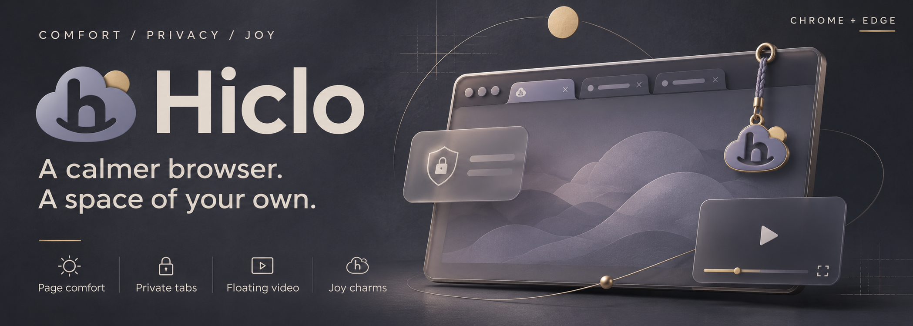

<p align="center">
  
</p>

<h1 align="center">Hiclo — Comfort, Privacy & Joy</h1>

<p align="center">
  <strong>A calmer browser. A space of your own.</strong><br />
Page dimming, discreet tabs, floating video, and playful charms for desktop Chrome and Edge.
</p>

<p align="center">
  
  
  <br />
  
  
</p>

## 🌟 Overview

**Hiclo** brings comfort and personality to everyday browsing. Dim a bright page, soften its colors, tidy up tab titles, or keep a video nearby while you work. Then add a little Joy: a hanging figure that responds to your touch with a gentle swing.

Built with native HTML, CSS, and JavaScript, Hiclo runs locally without accounts, analytics, remote code, or external runtime assets.

## ✨ Key Features

- **Page lighting** — Adjust brightness from **0–100%**, with **100% as default**. Choose Natural, Warm, or Grayscale.
- **Website preferences** — Preview Display and Joy changes, then save for one site or all websites.
- **Discreet tabs** — Customize page titles and mask favicons.
- **Floating video** — Move and resize supported videos with native Picture-in-Picture, plus playback, mute, and seek controls.
- **Window sizing** — Save your preferred dimensions and optionally restore them at startup and for new windows.
- **Joy charms** — Add built-in figures or custom images with adjustable hooks, ropes, appearance, and motion.

## 🚀 Quick Installation

**Desktop Chrome 111+ or Microsoft Edge. No build step required.**

1. Download the repository using **Code → Download ZIP** and extract it, or clone it.
2. Open `chrome://extensions` or `edge://extensions`.
3. Enable **Developer mode**, select **Load unpacked**, and choose the folder containing [manifest.json](manifest.json).
4. Pin **Hiclo** from the extensions menu, then open it on a normal HTTP/HTTPS website.

> To update, replace the files, click **Reload** on the extensions page, and reload open webpages. Page effects are unavailable on protected browser pages.

## 🌐 Website Settings

Display and Joy preview changes before you choose where to save them.

| Action | Display and Joy behavior |
| --- | --- |
| Edit a setting | Preview on the current tab only. No implicit global save. |
| **This Site Only** | Save for this domain without changing the global baseline. |
| **All Websites** | Save globally and deactivate previous site overrides so it applies everywhere. |
| **Remove** | Delete this domain's override and return to the global configuration. |
| Close without saving | Discard the preview and restore saved settings. |

## 🎨 Charm Collection

Choose from the default charm figures or upload your own **PNG, JPEG, or WebP** images. Add up to **six figures** per configuration.

- **Controls:** Drag and release to swing, click to nudge, and move hooks sideways. Adjust size and opacity, pause motion, or lock figures for click-through browsing.

## ⚙️ Physics & Simulation Engine

Joy uses a segmented rope and Verlet integration to simulate gravity, tension, and swinging. Constraints keep the rope connected, while elastic stretch and damping create natural recoil and gradual settling after a drag.

## 🛠️ Architecture

```text
hiclo/
├── manifest.json          # MV3 entry points, permissions, icons
├── background.js          # Serialized saves, lifecycle, window actions
├── popup/
│   ├── popup.html         # Toolbar popup structure
│   ├── popup.css          # Brand tokens, themes, shared components
│   ├── popup.js           # Display, privacy, window, and video UI
│   ├── popup-layout.js / .css # Popup sizing and scrolling
│   └── theme.js           # Direct appearance toggle and persistent theme
├── features/
│   ├── display/
│   │   ├── display.js     # Display validation, domain keys, migration
│   │   └── content.js     # Page filters, metadata masks, tab previews
│   ├── joy/
│   │   ├── joy-core.js    # Validation, hook geometry, rope physics
│   │   ├── joy-state.js   # Draft editing and upload validation
│   │   ├── joy-store.js   # Global/site saves and image lifecycle
│   │   ├── joy-art.js     # Canvas hooks, ropes, character effects
│   │   ├── joy-content.js # Overlay, gestures, animation lifecycle
│   │   └── joy-popup.js / .css # Joy editor and scoped controls
│   └── video/
│       └── video.js       # Video discovery and native PiP controls
├── shared/
│   └── settings.js        # Shared defaults and preference validation
├── assets/
│   ├── hiclo-banner.png   # Project README banner
│   ├── brand/            # Hiclo identity and production notes
│   └── joy/              # Bundled figures and artwork credits
├── icons/                 # Packaged extension icons
├── tests/                 # Unit and browser regression suites
└── package.json           # Development scripts; no runtime dependencies
```

## 🧪 Testing & Development

Requires **Node.js 20+**; Playwright is included as a development dependency. Run these commands in PowerShell (use `npm` instead of `npm.cmd` in other shells).

```powershell
# Install dependencies and run unit tests
npm.cmd ci --ignore-scripts
npm.cmd test

# Install Chromium and run browser tests
npm.cmd exec playwright install chromium
npm.cmd run test:browser
npm.cmd run test:joy
npm.cmd run test:lifecycle
npm.cmd run test:popup
npm.cmd run test:appearance
```

## 🤝 Contributing

Fork the repository, make a focused change, and run the relevant tests. Open a pull request with a brief description and screenshots for visual changes. For bugs, include your browser, OS, and steps to reproduce.

## 📄 License

This project is licensed under the [MIT License](LICENSE) — feel free to use, modify, and distribute it freely.

---

<p align="center"><strong>Hiclo</strong> · Find your comfort. Leave a little space for joy. ☁️</p>
